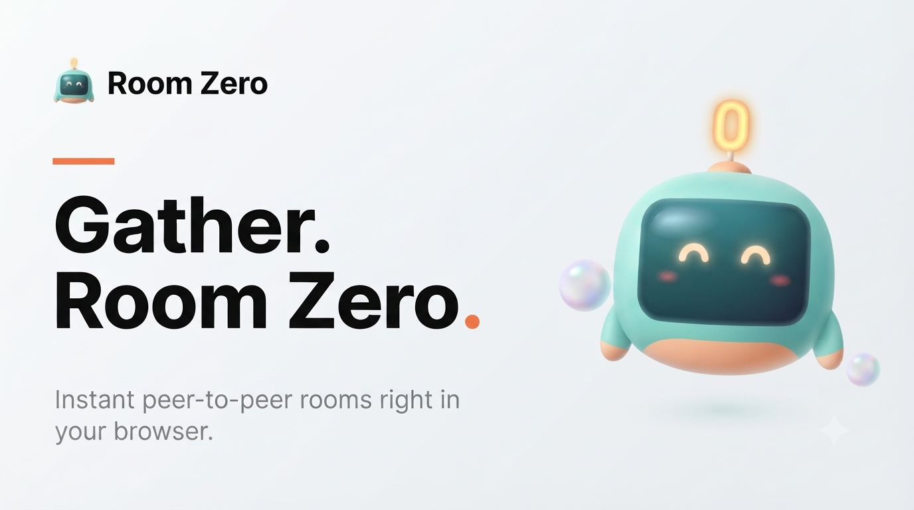

# ROOM//ZERO

**Step into a bio-secure mixed-reality lab, solve the mission, and guide the room with your hands.**

ROOM//ZERO is a Unity-based mixed-reality prototype built for the Meta VR Hackathon 2026. The experience places the player inside a three-room scientific facility where they use hand tracking, passthrough, and controller-free interaction to complete a lab mission, recover the Harvest Formula, and navigate a sequence of interactive challenges.

This project combines Meta XR / OpenXR integration, desktop fallback controls, a guided narrative layer, and a room-scale interactive system designed for MR demos. It is a prototype focused on immersive interaction, object manipulation, and AI-assisted room guidance.

How it works in one line: Meta XR and hand tracking give the player a real room and a live set of interactions; ROOM//ZERO layers in a scripted mission, guided NPC behavior, and a responsive lab environment where each room becomes a playable challenge.

<!-- VIDEO_URL -->
**▶ Demo and explanation video:** ~~Coming soon!~~



Built for the **Meta VR Hackathon 2026**. Repository and project documentation are still being finalized; use the sections below as the current project summary and onboarding guide.

## Run it in 3 steps

```text
1. Open the project in Unity 6 (6000.x LTS or newer).
2. Install OpenXR + Meta XR packages and enable Meta XR integration.
3. Use RoomZero > Build Demo Scene, then press Play.
```

For the compatibility checks and environment setup, use the runtime guidance in the project README and the helper script in `Tools/roomzero.sh`.

**Project setup notes:**
- **Unity:** any Unity 6 version meeting the project requirements; the repo documents compatibility expectations for Meta XR SDK and OpenXR setup.
- **Meta XR Simulator:** supported as a desktop simulation path for development and testing; enable the OpenXR and Meta XR feature groups before running.
- **RoomZero configuration:** build the scene and create the `RoomZeroConfig` asset before running the demo.

## The mission, and where it is verified

The project is structured around a room-based, narrative-first challenge loop. The current build consists of a three-room mission with guided tasks, object interactions, and environmental feedback.

| Experience | What happens | Status |
|---|---|---|
| **Room 1: Seed Vault Lab** | Recover formula fragments and open the seed vault. | Prototype-ready |
| **Room 2: Hydroponics Greenhouse** | Solve the nutrient-mix and grow-light balance puzzles. | Prototype-ready |
| **Room 3: Gene Lab** | Complete microscope and splicing tasks to progress the mission. | Prototype-ready |
| **Dr. Asha guidance loop** | A virtual lab guide narrates the next step, explains the task, and steps back when the player takes over. | Implemented |
| **Bio-secure entrance** | Palm-scanner interaction unlocks the lab and triggers the scene’s real-world MR flow. | Implemented |

The project is designed for hands-on exploration in a mixed-reality room: players can scan the environment, interact with objects, manipulate devices, inspect tasks, and progress through a sequence of clues and mini-games.

## No headset? Use the simulator

- The project supports desktop simulation and Meta XR Simulator workflows for local development.
- Enable the required XR packages and use the simulator as a test path before deploying to a headset.
- Desktop mode includes keyboard controls and a fallback UI so the scene can be tested without MR hardware.

Common desktop controls include:
- **B**: start the quest
- **N**: advance to the next room after a win
- **V**: mission-related action / interaction shortcut
- **F**: focus the next target
- **H**: hint
- **P**: pause
- **0-9 + Enter**: input code or puzzle actions
- **J**: toggle help in desktop mode

### Limitations
As of now, the Meta XR Simulator work only on Windows and Mac (specifically Apple Silicon Macs). It does not natively support Intel Macs or Linux. If you are on those platforms, you must use a headset for testing.

## The core experience

ROOM//ZERO is built around a goal-driven spatial narrative. The player moves through a lab environment, interacts with physical or pseudo-physical objects, and solves a series of room challenges that mirror a fictional biotech research flow.

1. **Enter the environment.** The lab scene is built to work in a headset and also supports simulation-based testing.
2. **Inspect and interact.** Players use the room, object tags, and mission prompts to identify actions and targets.
3. **Solve the challenge.** Each room introduces a short procedural puzzle or manipulation sequence, such as formula matching, lighting balance, or genetic pattern matching.
4. **Advance the story.** Dr. Asha guides the experience and confirms when progress is correct.

## What is in this project

The repo is a Unity project package and includes the core runtime code, interaction modules, environment assets, and MR setup files required for the demo.

- **`Assets/RoomZero/`** — project-specific assets, room config, characters, fixtures, and scene-building logic
- **`Assets/RoomZero/Scripts/`** — bootstrap, runtime orchestration, MR integration, UI, and room logic
- **`Assets/RoomZero/Fixtures/`** — sample mission-plan and room-map JSON data for room logic and interaction definitions
- **`Assets/RoomZero/Characters/`** — character assets and the Dr. Asha setup
- **`ProjectSettings/`** — Unity settings for XR, quality, and project compatibility
- **`Tools/roomzero.sh`** — developer helper script for checking dependencies and local setup

## Project status

This repository is a functional Unity prototype for a spatial lab experience and is structured around the RoomZero demo infrastructure. It is intended for developer setup, local testing, and iterating on the MR mission flow.

### Current project state
- Unity project scaffolded and configured for XR/MR use
- Demo room and mission structure implemented
- Meta XR and desktop compatibility paths included
- AI / remote-agent support wired in through the RoomZero config and bootstrap flow
- Documentation is being consolidated for handoff and presentation

## License

This project is released under a custom hackathon-only license for submission and evaluation purposes only.

- Commercial use is strictly prohibited.
- Public redistribution or production deployment is not allowed without written permission.
- The project may be used for hackathon demo, internal testing, and non-commercial evaluation only.
- See [LICENSE](LICENSE) for the full terms.

## Credits and notes

- Project concept: **ROOM//ZERO**
- Platform: **Unity 6 + OpenXR + Meta XR**
- Target experience: **mixed reality lab challenge prototype**
- Demo style: **MR mission room with guided NPC and object interactions**
- Repository URL: https://github.com/puspamadak/room-zero

This project is designed as a hackathon prototype and is not tied to a production deployment or public release pipeline yet. The current focus is demonstrating the room experience, the interaction model, and the flow of the science-mission gameplay loop.